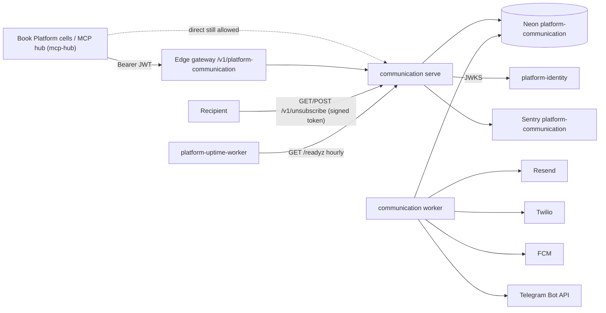
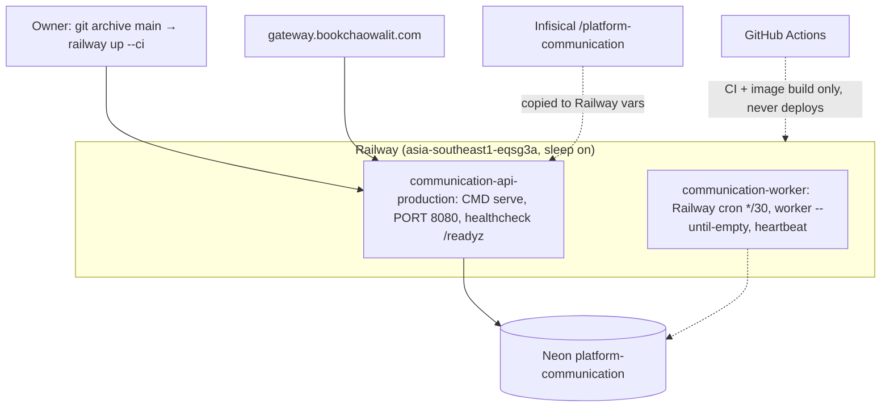

# Book Communication Platform — System Architecture

เอกสารนี้สรุปสถาปัตยกรรมของ platform `communication` จากโค้ดและ config ใน repo (ณ `origin/main` `f88cd54`, 2026-11-04) รายละเอียดอยู่ใน Core 22 diagram pack [`docs/diagrams/`](../docs/diagrams/README.md) และ [`docs/runtime.md`](../docs/runtime.md); เอกสารนี้ลิงก์ ไม่คัดลอก
ข้อเท็จจริง hosting ที่ไม่อยู่ใน repo อ้าง `ops record: book-platforms-status (2026-11-03)` และ `ops record: api-gateway-edge (2026-11-03)`

หมายเหตุ tier และความขัดแย้งของเอกสาร: `docpack.yaml` ยังเป็น `tier: L0`; `README.md`, `PRODUCT.md`, `contract.json` (status `scaffolded`) และ staging plan ใน `docs/runtime.md` ("not executed") บอกว่ายังไม่ deploy แต่ ops record ระบุว่า `communication-api-production` live (CLI deploy `bea8412`, `/readyz` 200) เอกสารนี้ใช้ ops record สำหรับสถานะ hosting และไม่เปลี่ยน tier อัปเดต 2026-11-10: README/PRODUCT/runtime.md แก้ให้ตรงกับ hosting แล้ว (contract.json คง `scaffolded` ตาม activation guard) และมี cron worker `communication-worker` แล้ว

## 1. Architecture style และเหตุผล

- **Microservice บน shared core + transactional outbox**: API รับคำขอส่งข้อความแล้วเขียนลง `message_outbox` ใน transaction และตอบ 202 ทันที; การส่งจริงทำโดย worker แยก process ([ADR-0001](../docs/diagrams/08-adr/ADR-0001-durable-outbox-with-leases.md)) เหตุผล: provider ภายนอก (Resend, Twilio, FCM, Telegram) ช้าหรือล่มได้ และการส่งซ้ำไปหาคนจริงเป็นความเสียหาย จึงต้องมี state ที่ทนทานและ "ไม่ retry เมื่อไม่แน่ใจ"
- **Ports & adapters สำหรับ provider**: `adapters.py` มี adapter ต่อ channel; channel ที่ไม่มี credential ถูกปิด และ `/readyz` ต้องการอย่างน้อยหนึ่ง adapter
- **Database-per-service + forced RLS**: Neon project ของตัวเอง, workspace จาก claim `ws` ([ADR-0002](../docs/diagrams/08-adr/ADR-0002-own-database-forced-rls-workspace-jwt.md))
- **Privacy by design สำหรับ opt-out**: เก็บเฉพาะ HMAC hash ของ address, ตรวจก่อนส่งทุกจุด ([ADR-0004](../docs/diagrams/08-adr/ADR-0004-keyed-hash-opt-out-before-send.md))
- **Serverless**: Railway sleep on + Neon free project ([ADR-0003](../docs/diagrams/08-adr/ADR-0003-railway-serverless-docker-cli-deploy.md))

## 2. Quality-attribute scenarios

| ID | Attribute | Scenario (stimulus → response) | กลไก | หลักฐาน |
|---|---|---|---|---|
| QA-01 | Reliability (no duplicate) | caller retry `POST /v1/messages` ด้วย `Idempotency-Key` เดิมพร้อมกัน → row เดียว; payload ต่าง → 409 | `UNIQUE(workspace_id, event_key)` + fingerprint | `runtime_tests/test_runtime.py::test_outbox_concurrent_idempotency_and_tenants` |
| QA-02 | Reliability (no double send) | worker ตายระหว่างส่ง (lease หมด ขณะ `sending`) → สถานะ `uncertain` ไม่ส่งซ้ำอัตโนมัติ | บันทึก `sending` ก่อน I/O, fencing ด้วย lease token | `test_worker_persists_before_send_and_ambiguity_stops_retry`, `test_claim_fencing_and_recovery` |
| QA-03 | Resilience | provider ตอบ 429 → retry backoff `least(3600, 2^attempts)` s จนถึง `max_attempts` (default 3) แล้ว `dead` | `finish` ใน `store.py` | `test_retry_dead_and_success`, `test_default_max_attempts_matches_accepted_retry_policy` |
| QA-04 | Privacy / compliance | ผู้รับกด one-click unsubscribe (RFC 8058) หรือ Telegram ตอบ 403 → บันทึก opt-out และข้อความที่ค้างถูก `suppressed` ก่อนเรียก provider | opt-out check ที่ `create`, `claim`, `mark_sending` | `runtime_tests/test_opt_out.py`, `test_unsubscribe.py` |
| QA-05 | Isolation | token workspace A เขียน/อ่าน outbox ของ B → ปฏิเสธ | forced RLS | `test_outbox_force_rls_rejects_foreign_write_and_stale_finish` |
| QA-06 | Capacity protection | queue ของ workspace เกิน `max_pending` → ปฏิเสธ (`QueueFull`) แต่ replay ของ key เดิมยังได้ | count ก่อน insert | `test_workspace_pending_queue_is_bounded_and_replay_survives_limit` |
| QA-07 | Privacy (observability) | exception มี email/เบอร์โทร → Sentry ได้แค่ type/stack/route | `before_send` ทิ้ง free text | `runtime_tests/test_sentry_boundary.py`, [ADR-0005](../docs/diagrams/08-adr/ADR-0005-sentry-no-free-text.md) |

ยังไม่มีเป้าหมายตัวเลข (delivery latency, success rate) ใน repo

## 3. Context diagram

ภาพเต็ม: [05-c4-context.md](../docs/diagrams/05-c4-context.md)

Gateway route `platform-communication` → `https://communication-api-production.up.railway.app` อยู่ใน platform-api-gateway `routes.json` @ `4a31ff5`; ไม่พบ consumer ที่ระบุว่าเรียก communication ผ่าน gateway นอกจาก MCP hub (ops record: api-gateway-edge)

## 4. Components / containers

image เดียวรันได้ 3 คำสั่ง (`__main__.py`): `serve`, `worker`, `migrate` ภาพ: [06-c4-container.md](../docs/diagrams/06-c4-container.md), [07-c4-component.md](../docs/diagrams/07-c4-component.md)

| Container / component | เทคโนโลยี | หน้าที่ | หลักฐาน |
|---|---|---|---|
| `serve` | Python 3.12, FastAPI, uvicorn (limit_concurrency 100) | `POST/GET /v1/messages`, `GET /v1/messages/{id}`, `POST /v1/opt-outs`, `GET/POST /v1/unsubscribe` (HTML, ไม่ต้อง auth; token คือ authority) | `app.py` |
| `worker` | Python 3.12 loop | claim ทีละข้อความของ `COMMUNICATION_WORKSPACE_ID`, idle sleep 0.5 s | `worker.py`, `__main__.py` |
| `migrate` | one-off | `MigrationRunner` namespace `communication` ด้วย DDL role | `migrations.py` |
| `store.py` `OutboxStore` | psycopg | create/claim (`FOR UPDATE SKIP LOCKED`)/mark_sending/finish, opt-out, unsubscribe | `store.py` |
| `adapters.py` | httpx (timeout 5 s, no redirect, max 64 KiB) | Resend, Twilio, FCM v1, Telegram `sendMessage`; classify response | `adapters.py`, `tests/test_delivery_gate.py` |
| `keys.py` | HMAC-SHA256 | derive `recipient-hash` และ `unsubscribe-token` จาก `COMMUNICATION_SECRET` | `keys.py` |
| `_sentry.py` + `CaptureErrors` | sentry-sdk | errors only, no free text | `_sentry.py` |
| core boundary/auth/db | platform-backend-core @ `21d5f44` | body limit, request id, redacted 500, `TokenVerifier`, pool max 8, diagnostics | ADR-0002, 07 |

## 5. Tech stack

| ชั้น | เทคโนโลยี | หลักฐาน |
|---|---|---|
| Runtime | Python ≥ 3.12, image `python:3.12-slim` two-stage, UID 65532 | `pyproject.toml`, `Dockerfile` |
| Shared core | `platform-backend-core==0.1.0` pin Git commit `21d5f44d26220080cbed43b9807979dc84a8533a` (`[tool.uv.sources]`, `uv.lock`; Dockerfile `pip wheel` จาก commit เดียวกัน) | `pyproject.toml`, `Dockerfile`, `tests/test_build_hygiene.py::test_core_comes_from_the_ci_pinned_commit` |
| Server / HTTP client | uvicorn, httpx | `pyproject.toml` |
| Observability | sentry-sdk ≥ 2.72 | `_sentry.py` |
| Tooling | ruff 0.17.1, mypy 2.4.0, pytest-cov 7.1.0 | `pyproject.toml` |
| CI | platform-ci-workflows `ci-python.yml` / `security.yml` @ `87dc5e1c` (v1.1.1) + job `contract` เอง + `shared-runtime.yml` (image build) | `.github/workflows/` |

**ความผูกพันกับ `platform-backend-core`**: core เป็น runtime dependency หลัก (HTTP boundary, auth, DB pool, migrations); fix ของ core ที่พบใน production (pool check ก่อนใช้, pool wait 20 s / connect timeout 15 s สำหรับ Neon resume) มาถึงเพราะ pin `21d5f44`; ต่างจาก Dockerfile ของ security ที่ใช้ `uv sync --frozen`, Dockerfile ของ communication ติดตั้ง core ด้วย `pip wheel` จาก Git URL และไม่ได้ใช้ `uv.lock` (ต้องพึ่ง test build hygiene ให้ commit ตรงกัน)

## 6. Data stores

| Store | ข้อมูล | กลไก | หลักฐาน |
|---|---|---|---|
| Neon (project ของ service) ตาราง `message_outbox` | channel, recipient (raw), body, template, status (`queued/leased/sending/delivered/dead/uncertain/suppressed`), attempts, lease, provider_id | forced RLS, `UNIQUE(workspace_id, event_key)` | `migrations.py`, [09-erd.md](../docs/diagrams/09-erd.md), [11-state-machines.md](../docs/diagrams/11-state-machines.md) |
| ตาราง `message_opt_out` | `recipient_hash` (HMAC), channel/wildcard, source, event id | forced RLS, ไม่เก็บ address | `migrations.py`, ADR-0004 |
| `platform_schema_migrations` | checksum migration | readiness | core `MigrationRunner` |

ไม่มี retention/purge ของ `message_outbox` ในโค้ด (raw recipient และ body อยู่ถาวร): ดู Open questions

## 7. Integrations

| ระบบ | ทิศทาง | ใช้ทำอะไร | สถานะ | หลักฐาน |
|---|---|---|---|---|
| platform-identity | communication → identity | JWKS (`JWT_JWKS_URL`), audience `communication-api` | live (ops record) | `__main__.py`, ops record |
| Edge gateway | gateway → communication | route `platform-communication` | route มีแล้ว | `routes.json` @ `4a31ff5` |
| Remote MCP hub | client → communication | cell `platform-communication` | live 2026-11-03 | ops record |
| Resend | worker → Resend | email, `Idempotency-Key: message/<uuid>` | ต้องมี `RESEND_FROM` (owner follow-up) | `adapters.py`, ops record |
| Twilio | worker → Twilio | SMS | ไม่ทราบว่าตั้ง credential หรือยัง | `adapters.py` |
| FCM v1 | worker → FCM | push | ไม่ทราบ | `adapters.py` |
| Telegram Bot API | worker → Telegram | message; 403 = blocked → opt-out | ไม่ทราบ | `adapters.py`, `test_telegram_blocked_by_user_records_opt_out` |
| platform-notifications-api | CI only | server-parity tests กับ commit `57dd0975` | CI | `check.yml` job `contract` |
| Neon | → DB | `DATABASE_URL` | live | ADR-0003 |
| Sentry | → Sentry | errors only | live | ADR-0005 |
| R2 / CF Queues / Kafka | — | ไม่ใช้; queue คือ outbox ใน Postgres | not applicable | `src/` |

## 8. Deployment topology

ภาพเต็ม: [16-deployment.md](../docs/diagrams/16-deployment.md)

- ตัวแปร (ชื่อเท่านั้น): `DATABASE_URL`, `JWT_ISSUER`, `JWT_AUDIENCE`, `JWT_JWKS_URL` หรือ `JWT_PUBLIC_KEY`, `COMMUNICATION_SECRET`, `COMMUNICATION_PUBLIC_URL`, `COMMUNICATION_WORKSPACE_ID` (worker), `RESEND_API_KEY`, `RESEND_FROM`, `TWILIO_ACCOUNT_SID`, `TWILIO_AUTH_TOKEN`, `TWILIO_FROM`, `FCM_PROJECT_ID`, `FCM_ACCESS_TOKEN`, `TELEGRAM_BOT_TOKEN`, `SENTRY_DSN`, `PORT`
- environment เดียว (production); staging plan ใน `docs/runtime.md` ถูกข้ามไป (deploy production ตรง)

## 9. ADR สำคัญ

| ID | การตัดสินใจ | ไฟล์ |
|---|---|---|
| ADR-0001 | Durable PostgreSQL outbox พร้อม lease; ส่งที่ไม่แน่ใจไม่ retry | [ADR-0001](../docs/diagrams/08-adr/ADR-0001-durable-outbox-with-leases.md) |
| ADR-0002 | DB ของตัวเอง, forced RLS, workspace จาก JWT `ws` | [ADR-0002](../docs/diagrams/08-adr/ADR-0002-own-database-forced-rls-workspace-jwt.md) |
| ADR-0003 | Railway serverless (Singapore) จาก Dockerfile, deploy ด้วย CLI | [ADR-0003](../docs/diagrams/08-adr/ADR-0003-railway-serverless-docker-cli-deploy.md) |
| ADR-0004 | Opt-out ก่อนส่ง, keyed HMAC hash, one-click unsubscribe | [ADR-0004](../docs/diagrams/08-adr/ADR-0004-keyed-hash-opt-out-before-send.md) |
| ADR-0005 | Sentry errors only, ไม่มี free text | [ADR-0005](../docs/diagrams/08-adr/ADR-0005-sentry-no-free-text.md) |

## 10. Fitness functions

| Guard | ตรวจอะไร | ที่อยู่ |
|---|---|---|
| Contract + schema pin + server parity (3.11 + 3.12) | contract, vendored schema ตรง pin, parity กับ platform-notifications-api @ `57dd0975` | `check.yml` job `contract`, `scripts/check.sh`, `tests/test_contract_check.py`, `tests/test_drift_checks.py` |
| Delivery gate | provider fixtures ครบ success/failure/timeout, idempotency header, no credentials ใน request, max attempts ตรง policy, console ไม่ใช่ delivery | `tests/test_delivery_gate.py` |
| Build hygiene | action SHA-pinned, Dockerfile multi-stage + non-root, core จาก commit เดียวกับ CI, CI build image ไม่ push | `tests/test_build_hygiene.py`, `shared-runtime.yml` |
| Runtime tests (Postgres จริง) | outbox idempotency, fencing, ambiguity, retry/dead, RLS, queue bound, opt-out, unsubscribe, pool reuse, error mapping | `runtime_tests/*.py` |
| Coverage gate | ≥ 90% (ratchet จาก 90.34% วันที่ 2026-11-03) | `check.yml` `coverage-threshold: "90"` |
| Lint / type | ruff (E9, F, I, UP, B), mypy | `pyproject.toml` |
| Security baseline | shared `security.yml` | job `security` |
| Deploy gate | Railway healthcheck `/readyz` (DB, schema, RLS, privilege, ≥ 1 adapter) | `railway.toml` |

## 11. เอกสารลงรายละเอียด phase 07

| Template | สถานะ | ไฟล์ / เหตุผล |
|---|---|---|
| `sdlc/infrastructure-and-network-design.md` | partial (ภาพ) | [16-deployment.md](../docs/diagrams/16-deployment.md), [19-service-dependency-map.md](../docs/diagrams/19-service-dependency-map.md) |
| `sdlc/observability-design.md` | partial | [20-observability.md](../docs/diagrams/20-observability.md); worker ไม่มี healthcheck และ error ของ worker ไม่ถึง Sentry |
| `sdlc/capacity-performance-and-cost-plan.md` | missing | ไม่มี workload model; ค่า provider ต่อข้อความยังไม่ประเมิน |
| `sdlc/failure-mode-analysis.md` | partial | [13-threat-model.md](../docs/diagrams/13-threat-model.md), [14-backup-dr.md](../docs/diagrams/14-backup-dr.md), [21-incident-response.md](../docs/diagrams/21-incident-response.md) |
| `sdlc/async-integration-contract.md` | partial | outbox/worker อธิบายใน [10-sequences.md](../docs/diagrams/10-sequences.md), [11-state-machines.md](../docs/diagrams/11-state-machines.md), [`docs/runtime.md`](../docs/runtime.md) "Outbox API and workers"; ยังไม่มีเอกสารตาม template |
| `sdlc/frontend-architecture.md` | partial | UI เดียวคือหน้า unsubscribe HTML ใน `app.py` (CSP `default-src 'none'`, `no-store`); ไม่ต้องมีเอกสารแยก |
| `sdlc/tech-debt-register.md` | missing | findings อยู่ใน [diagrams README](../docs/diagrams/README.md) |
| `operations/system-landscape.md` | external | central C4 ยังไม่มี service นี้ |
| `development-cycle/vendor-dependency-review.md` | missing | Resend, Twilio, FCM, Telegram, Railway, Neon, Sentry |

## Open questions

- ~~มี Railway service `worker` แล้วหรือยัง~~ ตอบแล้ว 2026-11-10: `communication-worker` เป็น Railway cron ทุก 30 นาที (`worker --until-empty`, ไม่ใช่ always-on เพราะ poll 0.5 วินาทีจะทำให้ Neon ตื่นตลอด ~182 CU-h/เดือน เกินโควตาฟรี 100) `COMMUNICATION_WORKSPACE_ID` = owner workspace; smoke email ถึง `delivered`
- worker ส่งได้ทีละ workspace (`COMMUNICATION_WORKSPACE_ID` เดียว): จะรองรับหลาย workspace อย่างไร
- channel ใน production: email (Resend, `RESEND_FROM` ตั้งแล้ว 2026-11-09) และ Telegram มีตัวแปร; SMS (Twilio) และ push (FCM) ยังไม่ตั้ง
- commit ที่รันจริง: ops record ระบุ CLI deploy `bea8412`; main คือ `f88cd54`
- consumer contract (BOO-150: `POST /v1/notifications`, `dedupe_key`, `recipient_ref`) ต่างจาก runtime (`/v1/messages`, `Idempotency-Key`, raw `recipient`): จะทำ adapter หรือแก้ contract
- retention ของ raw recipient/body ใน `message_outbox` และ backup/restore drill (14)
- worker/startup errors ไม่ถึง Sentry (`__main__` แปลงเป็น `SystemExit`)
- `/metrics`, `/docs`, `/openapi.json` เปิดไม่ต้อง auth (12, 13)
- ~~เอกสารยังบอกว่าไม่ deploy~~ แก้แล้ว 2026-11-10 ยกเว้น `contract.json` status ที่ต้องรอ activation evidence

## การอนุมัติ

| บทบาท | สถานะ | วันที่ | ลงนาม |
|---|---|---|---|
| Solution Architect (Book Dev) | รอตรวจ | — | [ต้องยืนยัน] |
| Owner | รอตรวจ | — | [ต้องยืนยัน] |

## แหล่งข้อมูล

อ่านที่ `origin/main` `f88cd5425b0e591cef6dc03f918a96e757615f25` (2026-11-04):

- `pyproject.toml`, `Dockerfile`, `railway.toml`, `.github/workflows/check.yml`, `.github/workflows/shared-runtime.yml`, `DOCPACK/docpack.yaml`
- `src/platform_communication/__main__.py`, `app.py`, `store.py`, `worker.py`, `adapters.py`, `keys.py`, `migrations.py`, `_sentry.py`
- `tests/test_build_hygiene.py`, `test_delivery_gate.py`, `runtime_tests/test_runtime.py`, `test_opt_out.py`, `test_sentry_boundary.py`
- `docs/runtime.md`, `docs/diagrams/` (README, 05, 06, 07, 16, 08-adr/*)
- platform-api-gateway `routes.json` @ `4a31ff5` (route `platform-communication`)
- ops record: book-platforms-status (2026-11-03), ops record: communication-runtime (2026-10-29), ops record: api-gateway-edge (2026-11-03)
