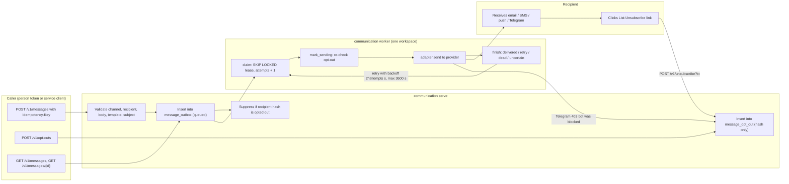
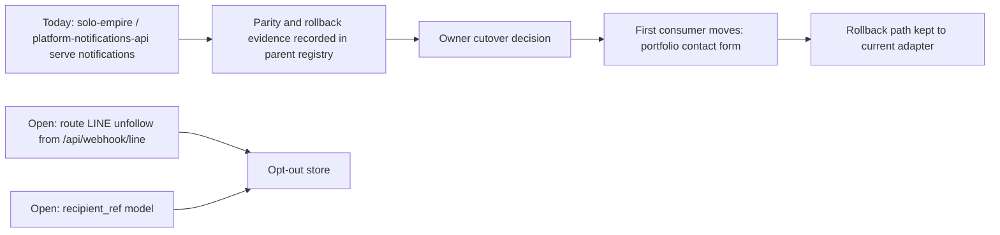

# 01 — Business process (As-Is / To-Be)

platform-communication เป็น central platform service สำหรับ capability `communication` (email, SMS, push, Telegram):
caller ส่งข้อความเข้า durable outbox ผ่าน API แล้ว delivery worker ส่งต่อให้ provider ทีละ workspace
ไม่มี UI ยกเว้นหน้า unsubscribe แบบ one-click (RFC 8058)

## As-Is (จากโค้ดบน `main` `3a35541`)

Sources: `src/platform_communication/app.py`, `src/platform_communication/store.py`, `src/platform_communication/worker.py`, `src/platform_communication/adapters.py`, `src/platform_communication/__main__.py`, `docs/runtime.md`

ขั้นตอนสำคัญ:
- caller ได้ 202 เมื่อ row ถูกบันทึกถาวรแล้ว ไม่ใช่เมื่อส่งสำเร็จ; replay ด้วย key เดิม payload เดิมได้ row เดิม, payload ต่างได้ 409
- opt-out ถูกบังคับก่อนเรียก provider ทุกครั้ง (ตอน `create`, `claim`, `mark_sending`) และไม่นับ attempt
- `uncertain` ไม่ถูกส่งซ้ำอัตโนมัติ: ต้อง reconcile กับ provider log โดย operator (`docs/runtime.md` "Outbox API and workers")

## To-Be (จาก `PRODUCT.md`, `docs/UPGRADE-PLAN.md`, `docs/runtime.md`, `docs/gates/BOO-150-communication-delivery-gate.md`)

Sources: `PRODUCT.md` (Measures, Operating Context), `docs/runtime.md` (Staging plan step 5, Opt-out "Not done here"), `docs/gates/BOO-150-communication-delivery-gate.md` (Gap list, Still open), `docs/UPGRADE-PLAN.md`

## Open questions

- เกณฑ์ cutover ของ runtime ยังเป็น `[ต้องยืนยัน]` ใน `PRODUCT.md` Measures
- `PRODUCT.md`, `README.md` และ `contract.json` ยังเขียนว่า status `scaffolded` / "no production activation" ขณะที่ ops record: book-platforms-status (2026-11-03) ระบุว่า `communication-api-production` live บน Railway: ต้องให้ owner ตัดสินว่าเอกสารใดคือความจริงปัจจุบัน
- ใครคือ consumer จริงคนแรกที่เรียก `/v1/messages` ใน production (ไม่มีหลักฐานใน repo)
