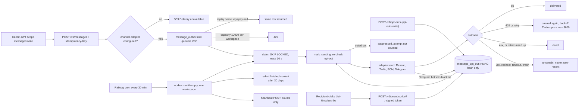
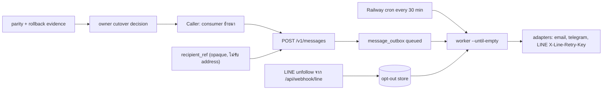

# 01 — Business process (As-Is / To-Be)

platform-communication เป็นบริการกลางของ capability `communication` (email, SMS, push, Telegram): caller ส่งข้อความเข้า durable outbox ผ่าน API แล้ว Railway cron worker ทุก 30 นาทีส่งต่อให้ provider ทีละ workspace พร้อมบังคับ opt-out ก่อนส่ง ผู้ใช้คือ owner และ service อื่นของ Book Platform; ไม่มี UI นอกจากหน้า unsubscribe แบบ one-click (RFC 8058)

Last reviewed: 2026-11-27 · commit `4c38af2`

## As-Is (จากโค้ดวันนี้)

Sources: `src/platform_communication/app.py`, `src/platform_communication/store.py`, `src/platform_communication/worker.py`, `src/platform_communication/_drain.py`, `src/platform_communication/adapters.py`, `src/platform_communication/__main__.py`, `docs/runtime.md`

ข้อเท็จจริงสำคัญจากโค้ด:

- caller ได้ 202 เมื่อ row ถูกบันทึกถาวร ไม่ใช่เมื่อส่งสำเร็จ; replay ด้วย key เดิม payload เดิมได้ row เดิม, payload ต่างได้ 409
- `max_attempts` default ในโค้ดคือ 3 (`Message` ใน `app.py`, `create` ใน `store.py`) แต่ `docs/runtime.md` เขียนว่า default 5 (ดู G4)
- worker หยิบได้สูงสุด 500 ข้อความต่อรอบ cron; `uncertain` ต้องให้ operator reconcile กับ provider log
- provider ที่ตั้งค่าจริงใน production: email (Resend) ส่งสำเร็จเมื่อ 2026-11-10; Telegram ตั้งค่าแล้ว; SMS และ push มีโค้ดแต่ไม่ได้ตั้งค่า (`docs/gates/BOO-150-communication-delivery-gate.md`) [ต้องยืนยัน]
- ยังไม่มี consumer ย้ายมาใช้ runtime นี้ และ task digest ยังรันใน `platform-notifications-api` (`PRODUCT.md`)

## To-Be (จาก `PRODUCT.md`, `docs/UPGRADE-PLAN.md`, `docs/gates/BOO-150-communication-delivery-gate.md`)

Sources: `PRODUCT.md` (Operating Context, Measures), `docs/gates/BOO-150-communication-delivery-gate.md` ("Still open after the decision", "Runtime mapping"), `docs/UPGRADE-PLAN.md`

## Gap

| ID | As-Is → To-Be | Status | Owner | Evidence |
|---|---|---|---|---|
| G1 | ไม่มี consumer ใช้ runtime; task digest ยังรันใน platform-notifications-api → parity + rollback evidence แล้ว owner ตัดสิน cutover | decide | owner | `PRODUCT.md`; `docs/gates/BOO-150-communication-delivery-gate.md` "Still open" |
| G2 | callers ส่ง address ดิบ (`recipient`) → opaque `recipient_ref` ตามสัญญา | decide | owner | `docs/gates/BOO-150-communication-delivery-gate.md` "Runtime mapping" |
| G3 | ไม่มี LINE adapter และไม่ route LINE unfollow เข้า opt-out → รองรับ LINE ตามสัญญา | decide | owner | `docs/gates/BOO-150-communication-delivery-gate.md` |
| G4 | โค้ดใช้ `max_attempts` default 3 แต่ `docs/runtime.md` เขียน 5 → ให้เอกสารตรงกับโค้ด | todo | claude | `src/platform_communication/app.py`; `docs/runtime.md` |
| G5 | `contract.json`, README, PRODUCT.md ยังเขียน status `scaffolded` ขณะที่ runtime live บน Railway → owner ตัดสินสถานะและเกณฑ์ activation | decide | owner | `PRODUCT.md` Measures [ต้องยืนยัน]; `docs/runtime.md` |
| G6 | registry `source_paths` และ `contract.json` `interfaces[].source` ล้าสมัย → อัปเดต | todo | claude | `docs/gates/BOO-150-communication-delivery-gate.md` "Still open" |

## Open questions

- เกณฑ์ activation/cutover ของ runtime (`PRODUCT.md` Measures ยังเป็น `[ต้องยืนยัน]`)
- consumer จริงรายแรกที่เรียก `/v1/messages` ใน production (ไม่มีหลักฐานใน repo); `docs/gates/` ระบุ portfolio contact form เป็นตัวเลือก
- channel ใดตั้งค่าใน production จริงนอกจาก email [ต้องยืนยัน]
