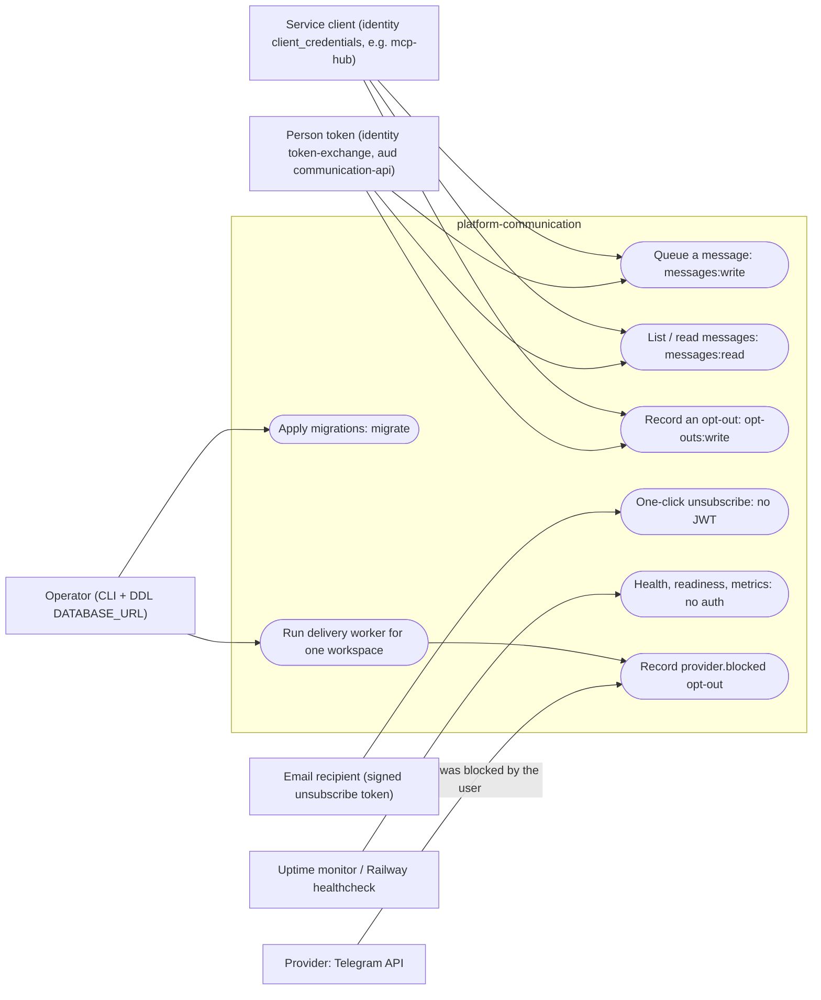

# 02 — Use cases

Actors คือสิ่งที่ service ตรวจจริง: JWT audience (`JWT_AUDIENCE`), claim `ws` (workspace) / `sub` (actor) และ scope แต่ละ route
(`platform_backend_core.require_scope`) บวก actor ที่ไม่ใช้ JWT (recipient ที่ถือ signed unsubscribe token, operator ที่รัน CLI, provider)

Sources: `src/platform_communication/app.py`, `src/platform_communication/__main__.py`, `src/platform_communication/worker.py`, `src/platform_communication/adapters.py` (`TelegramAdapter.blocked_marker`), platform-backend-core `src/platform_backend_core/http.py` (`require_scope`, `/healthz`, `/readyz`, `/metrics`) และ `auth.py` (`TokenVerifier` requires `sub`, `ws`, `iat`, `exp`, `jti`, `iss`, `aud`) at `21d5f44`, ops record: book-platforms-status (2026-11-03) (issuer, audience `<svc>-api`, MCP hub client `mcp-hub`)

| Actor | ตรวจอย่างไรในโค้ด | Use cases |
|---|---|---|
| Person token | RS256 JWT, issuer `JWT_ISSUER`, audience `JWT_AUDIENCE`, scope string | UC1–UC3 |
| Service client | เหมือน person token (service ไม่แยกประเภท token; ต่างกันที่ identity ออกให้) | UC1–UC3 |
| Email recipient | `Keys.read_unsubscribe_token` (HMAC 128-bit tag, workspace + message id) | UC4 |
| Operator | เข้าถึง Railway / `DATABASE_URL` DDL role และ `COMMUNICATION_WORKSPACE_ID` | UC5, UC6 |
| Provider | Telegram 403 body มี `bot was blocked by the user` | UC8 |

## Open questions

- service ไม่แยก person กับ service client: ทุก token ที่มี scope ถูกต้องทำได้เท่ากัน; ต้องการ owner-only operation หรือไม่
- scope ที่ identity client `mcp-hub` ถือสำหรับ audience `communication-api` ไม่ได้ระบุใน ops record (ระบุเพียง 31 owner scopes, 8 audiences)
- person token ยังใช้ไม่ได้จนกว่า owner ตั้ง `IDENTITY_GOOGLE_CLIENT_IDS` (ops record: book-platforms-status (2026-11-03))
