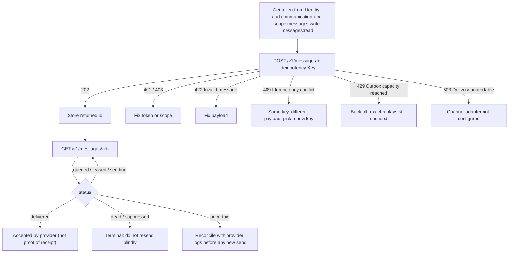
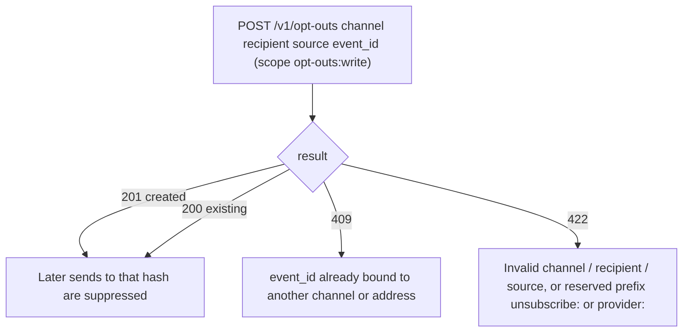
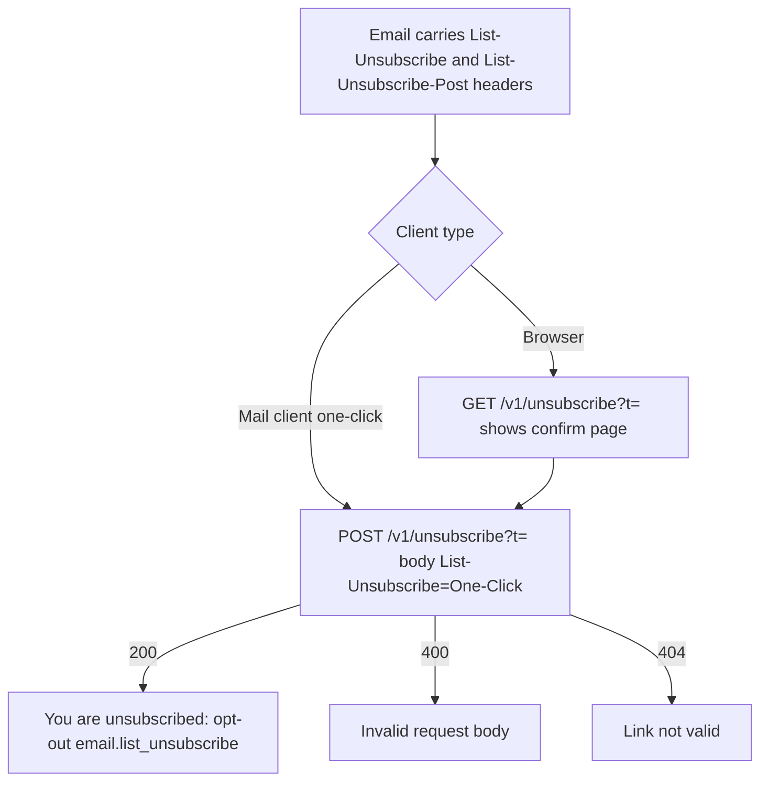
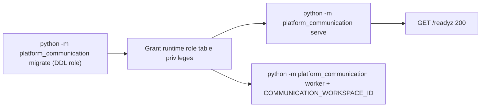

# 03 — User flows (API call flows per caller)

service นี้ไม่มีหน้า UI สำหรับผู้ใช้ยกเว้นหน้า unsubscribe; "user flow" จึงเป็นลำดับการเรียก API ของแต่ละ caller

## Flow A — caller ส่งข้อความและติดตามสถานะ

## Flow B — caller บันทึก opt-out

## Flow C — recipient กด unsubscribe ในอีเมล

## Flow D — operator ติดตั้งและรัน

Sources: `src/platform_communication/app.py`, `src/platform_communication/store.py`, `src/platform_communication/keys.py`, `src/platform_communication/adapters.py` (`ResendAdapter`, `unsubscribe_link`), `src/platform_communication/__main__.py`, `docs/runtime.md` (Staging plan, Outbox API and workers, Keyed hashes and one-click unsubscribe)

## Open questions

- ยังไม่มี consumer จริงใน repo; Flow A คือสัญญาตามโค้ด ไม่ใช่ journey ที่วัดจาก production
- `COMMUNICATION_PUBLIC_URL` ตั้งใน production แล้วหรือไม่ (ถ้าไม่ตั้ง อีเมลจะไม่มี List-Unsubscribe header และ Flow C ไม่เกิด)
