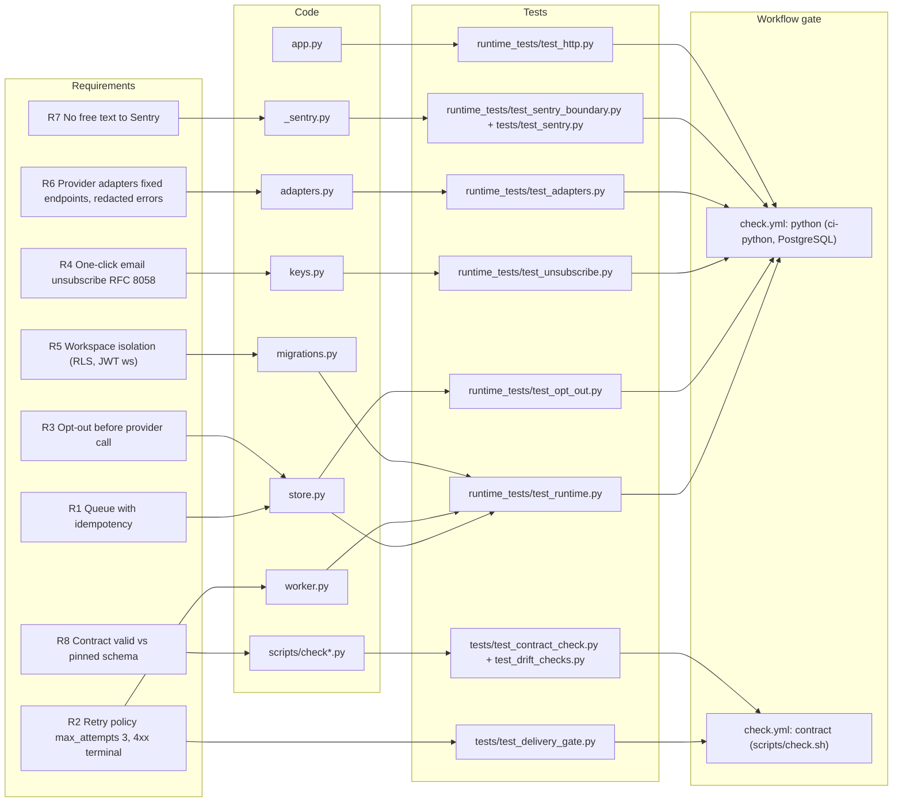

# 04 — Traceability (RTM)

ความต้องการมาจาก 3 แหล่งใน repo: BOO-150 gate ที่ owner accept เมื่อ 2026-10-16 (`docs/gates/BOO-150-communication-delivery-gate.md`,
`contracts/consumer/communication-delivery.consumer.v1.json`), runtime spec (`docs/runtime.md`) และ contract metadata (`contract.json`, `PRODUCT.md`)
ไม่มี `specs/` directory

| ID | Requirement | Source of requirement | Code | Tests | Gate / release |
|---|---|---|---|---|---|
| R1 | `POST /v1/messages` ต้องมี `Idempotency-Key`; replay ได้ row เดิม, payload ต่าง = 409 | `docs/runtime.md` Outbox API | `store.py` `create`, `fingerprint`; `app.py` | `test_runtime.py::test_outbox_concurrent_idempotency_and_tenants`, `test_opt_out.py::test_fingerprint_without_subject_keeps_the_pre_subject_form` | `check.yml` job `python` |
| R1b | Queue cap 10,000 active rows ต่อ workspace → 429 | `docs/runtime.md` | `store.py` `QueueFull` | `test_runtime.py::test_workspace_pending_queue_is_bounded_and_replay_survives_limit` | `python` |
| R2 | `max_attempts` 3, 429 retry, non-429 4xx dead, ambiguous = uncertain ไม่ส่งซ้ำ | BOO-150 retry policy (accepted 2026-10-16); `docs/runtime.md` | `adapters.py` `HTTPAdapter.request`; `worker.py`; `store.py` `finish` | `test_runtime.py::test_retry_dead_and_success`, `::test_worker_persists_before_send_and_ambiguity_stops_retry`, `test_opt_out.py::test_default_max_attempts_matches_accepted_retry_policy`, `tests/test_delivery_gate.py::test_max_attempts_agree` | `python`, `contract` |
| R3 | opt-out บังคับก่อน provider call, ไม่นับ attempt, scope `*` | BOO-150 opt-out policy | `store.py` `OPTED_OUT`, `claim`, `mark_sending`, `record_opt_out` | `test_opt_out.py` (16 tests) | `python` |
| R3b | Telegram 403 blocked → `provider.blocked` opt-out | BOO-150 signals | `worker.py`, `adapters.py` `TelegramAdapter` | `test_opt_out.py::test_telegram_blocked_by_user_records_opt_out` | `python` |
| R3c | LINE `unfollow` → opt-out | BOO-150 signals | **ไม่มี** (`docs/runtime.md` "Not done here") | `tests/test_delivery_gate.py::test_batch_unfollows_all_block` (reference module เท่านั้น) | gap |
| R4 | RFC 8058 List-Unsubscribe ด้วย signed token, ไม่เปิดเผย address | `docs/runtime.md` 2026-10-29 | `keys.py`, `adapters.py` `unsubscribe_link`, `app.py` `/v1/unsubscribe` | `test_unsubscribe.py` (13 tests) | `python` |
| R5 | workspace มาจาก JWT `ws` เท่านั้น; forced RLS | `docs/runtime.md` | `migrations.py` policies; core `db.py` `transaction` | `test_runtime.py::test_outbox_force_rls_rejects_foreign_write_and_stale_finish`, `test_opt_out.py::test_readiness_requires_forced_rls_on_the_opt_out_table` | `python` |
| R6 | provider HTTP: fixed HTTPS, no redirect, 5 s, ≤64 KiB | `docs/runtime.md` | `adapters.py` | `test_adapters.py` (5 tests) | `python` |
| R7 | ไม่มี free text ไป Sentry | commit `9c69f81` (PR #18) | `_sentry.py` | `test_sentry_boundary.py::test_no_exception_text_leaves_the_process`, `tests/test_sentry.py` | `python` |
| R8 | `contract.json` valid ต่อ schema ที่ pin sha256 | `PRODUCT.md` Measures | `scripts/check.py`, `check_schema_pin.py` | `tests/test_contract_check.py`, `tests/test_drift_checks.py` | `contract` |
| R9 | readiness ตรวจ migration checksum, RLS, privilege ทีละตัว | `docs/runtime.md` Independent review | `store.py` `ready` | `test_http.py` (4 tests) | `python` |
| R10 | Dockerfile multi-stage, non-root, core pin ตรงกับ CI | `docs/runtime.md` Container image | `Dockerfile` | `tests/test_build_hygiene.py` | `shared-runtime.yml` `image` |

Release: ไม่มี workflow ที่ deploy; release จริงคือ `railway up` แบบ CLI (ดู [18](18-git-release-workflow.md))

Sources: `docs/gates/BOO-150-communication-delivery-gate.md`, `contracts/consumer/communication-delivery.consumer.v1.json`, `docs/runtime.md`, `PRODUCT.md`, `src/platform_communication/*.py`, `tests/*.py`, `runtime_tests/*.py`, `.github/workflows/check.yml`, `.github/workflows/shared-runtime.yml`

## Gaps found

- consumer contract ที่ owner accept อธิบาย surface ของ server ปัจจุบัน (`POST /v1/notifications`, `dedupe_key`, permissions `notifications.notification:*`) แต่ runtime นี้ให้ `POST /v1/messages` + `Idempotency-Key` + scope `messages:*`: ไม่มี compatibility adapter ใน repo นี้
- consumer contract กำหนด `recipient_ref` แบบ opaque แต่ runtime รับและเก็บ `recipient` ตรงๆ (`message_outbox.recipient`)
- `tests/test_delivery_gate.py` ทดสอบ `reference/communication_policy.py` ซึ่งไม่ได้ต่อกับ runtime (gate doc ระบุ "Wired to runtime: no")

## Open questions

- ต้องการ RTM ID ทางการ (เช่น REQ-COMM-xx) หรือใช้ R1..R10 ตามตารางนี้
