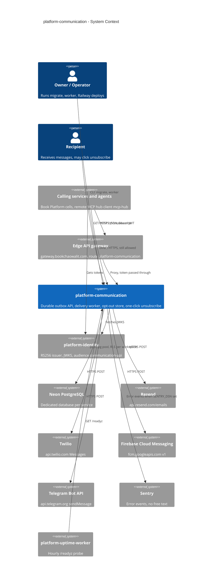

# 05 — C4 Context

Sources: `src/platform_communication/adapters.py` (provider URLs), `src/platform_communication/__main__.py`, `src/platform_communication/_sentry.py`, `src/platform_communication/app.py`, `docs/runtime.md`, ops record: book-platforms-status (2026-11-03) (identity issuer + JWKS, audience `<svc>-api`, own Neon project `platform-<svc>`, uptime worker hourly `/readyz`, MCP hub cell `platform-<svc>`), ops record: api-gateway-edge (2026-11-03), platform-api-gateway `routes.json` @ `4a31ff5`

## Open questions

- channel ไหน configured จริงใน production (ops record ระบุว่า `RESEND_FROM` ยังเป็น owner follow-up; `/readyz` 200 แปลว่ามีอย่างน้อยหนึ่ง adapter configured)
- ~~edge API gateway มี route ไปยัง communication หรือไม่~~ ตอบแล้ว 2026-11-04: route `platform-communication` → `https://communication-api-production.up.railway.app` ใน platform-api-gateway `routes.json` @ `4a31ff5`
- caller ตัวไหนเรียกผ่าน gateway จริง: ops record ระบุ MCP hub ใช้ gateway; cells อื่นไม่ระบุ
