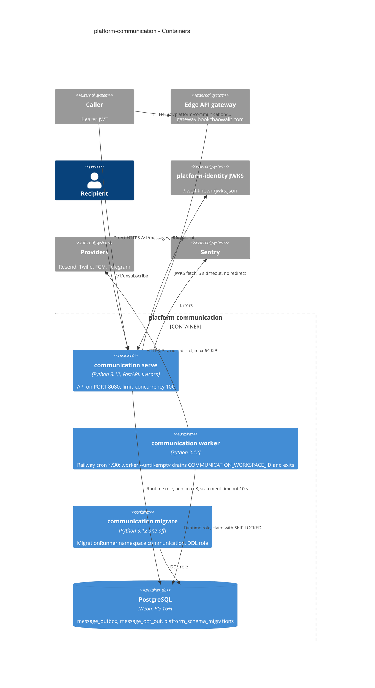

# 06 — C4 Container

image เดียว (`Dockerfile`) รันได้ 3 คำสั่ง: `serve`, `worker`, `migrate` (`src/platform_communication/__main__.py`)

Sources: `Dockerfile`, `.railway/railway.ts`, `src/platform_communication/__main__.py`, `src/platform_communication/app.py`, `src/platform_communication/worker.py`, `src/platform_communication/adapters.py`, `src/platform_communication/_sentry.py`, `docs/runtime.md`, platform-backend-core `src/platform_backend_core/db.py`, `auth.py`, `migrations.py` at `21d5f44`, platform-api-gateway `routes.json` @ `4a31ff5`

## Open questions

- ~~ไม่ยืนยันว่ามี Railway service สำหรับ `worker`~~ 2026-11-10: Railway cron `communication-worker` ทุก 30 นาที
- worker ไม่มีเส้นทางส่ง error ไป Sentry ที่หาเจอในโค้ด: `__main__.main` แปลงทุก exception เป็น `SystemExit` (Python ไม่เรียก excepthook สำหรับ `SystemExit`) และ `_sentry.capture()` ไม่ถูกเรียกที่ใด (ดู [20](20-observability.md))
- worker ไม่มี HTTP port: ตรวจด้วย uptime heartbeat `communication-worker` (2 ชม., `_heartbeat.py`) แทน healthcheck
