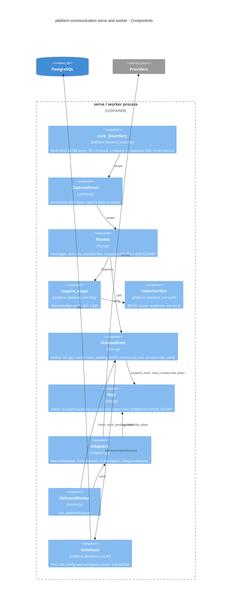

# 07 — C4 Component

Sources: `src/platform_communication/app.py`, `store.py`, `keys.py`, `adapters.py`, `worker.py`, `_sentry.py`, `errors.py`, platform-backend-core `http.py`, `auth.py`, `db.py` at `21d5f44`
