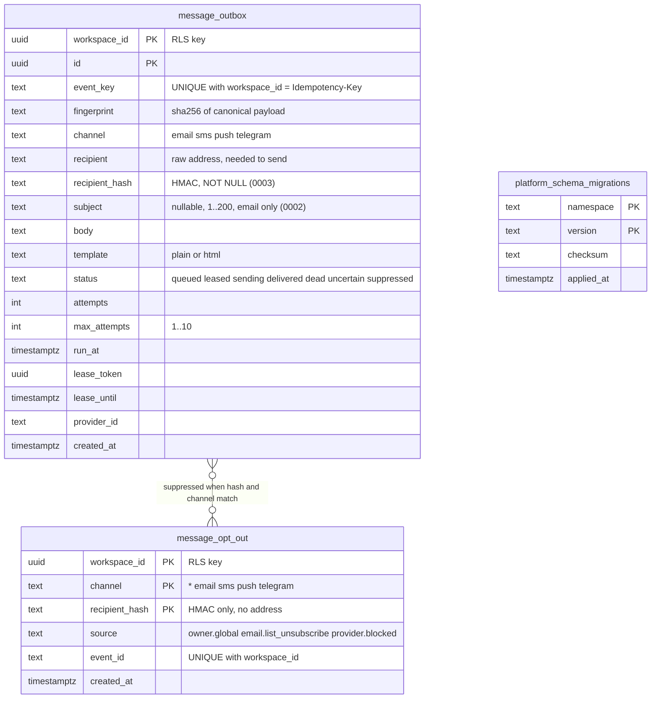

# 09 — ERD

schema มาจาก migration `0001`–`0003` ใน `src/platform_communication/migrations.py` (namespace `communication`) และตาราง history ของ core
ไม่มี foreign key ระหว่างตาราง: `message_opt_out` ผูกกับ `message_outbox` ด้วย `(workspace_id, recipient_hash)` และ channel (`channel IN (m.channel, '*')`) ใน SQL `OPTED_OUT`

Sources: `src/platform_communication/migrations.py`, `src/platform_communication/store.py` (`OPTED_OUT`, `PUBLIC`, `ready`), platform-backend-core `src/platform_backend_core/migrations.py` at `21d5f44`

## Indexes, RLS and runtime role

| Table | Index | RLS | Runtime grants (`store.ready`) |
|---|---|---|---|
| `message_outbox` | `(workspace_id,status,run_at,id)`, `(workspace_id,created_at,id)` | ENABLE + FORCE, policy `workspace` USING + WITH CHECK | SELECT, INSERT, UPDATE |
| `message_opt_out` | `(workspace_id,recipient_hash)` | ENABLE + FORCE, policy `workspace` | SELECT, INSERT |
| `platform_schema_migrations` | PK | none (shared history) | SELECT |

- runtime role ต้องเป็น NOSUPERUSER NOBYPASSRLS (core `Database._configure`); schema `public` USAGE
- API ไม่คืน `recipient_hash`, `fingerprint`, `lease_token`, `provider_id`, `event_key` (`PUBLIC` column list) แต่คืน `recipient` และ `body`
- ไม่มี DELETE grant และไม่มี purge job: ข้อมูลอยู่ถาวรจนกว่า operator จัดการ (`docs/runtime.md`)

ภาพ ERD กลางของ architecture-docs ([ERD-DIAGRAMS.md](https://github.com/bookchaowalit/architecture-docs/blob/main/docs/architecture/ERD-DIAGRAMS.md)) ไม่มีตารางของ service นี้

## Open questions

- retention ของ `message_outbox.body` / `recipient` หลัง terminal: `docs/runtime.md` บอกให้ตั้งก่อน production แต่ยังไม่มีค่า
