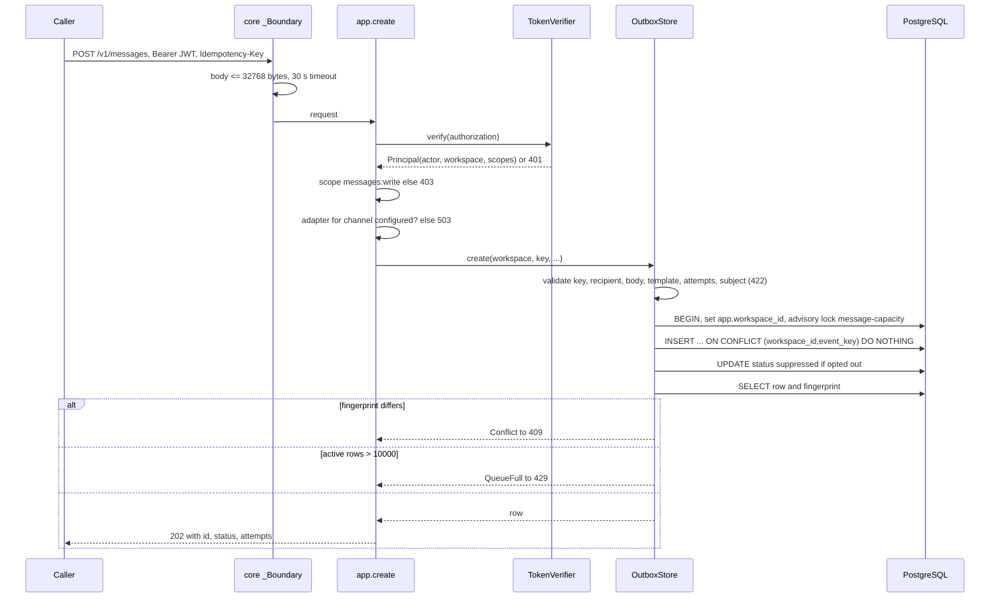
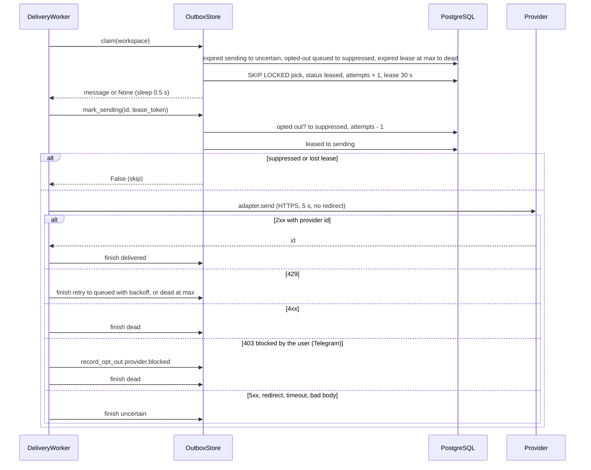
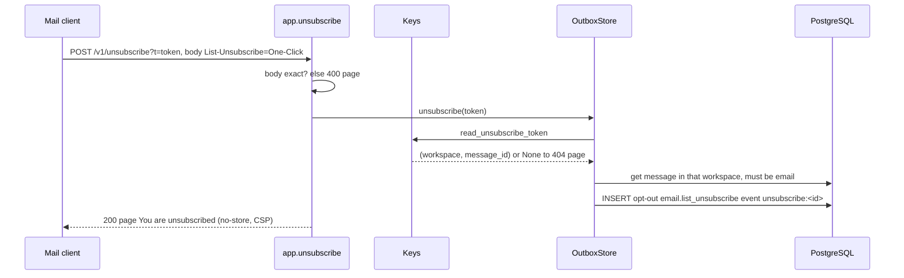
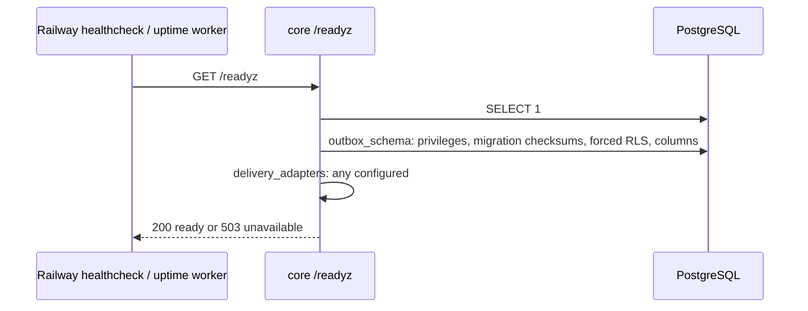

# 10 — Sequences

## S1 — Queue a message (`POST /v1/messages`)

## S2 — Worker delivers one message

## S3 — One-click unsubscribe

## S4 — Readiness probe

Sources: `src/platform_communication/app.py`, `store.py`, `worker.py`, `adapters.py`, `keys.py`, `__main__.py`, platform-backend-core `http.py`, `auth.py`, `db.py` at `21d5f44`, `.railway/railway.ts`, ops record: book-platforms-status (2026-11-03) (uptime worker hourly `/readyz`)
