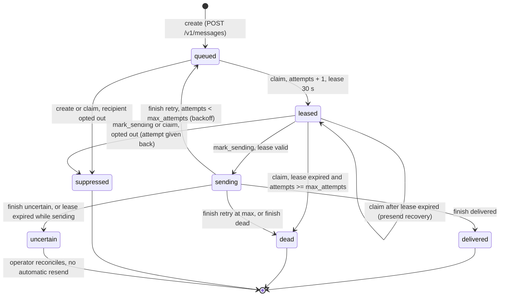
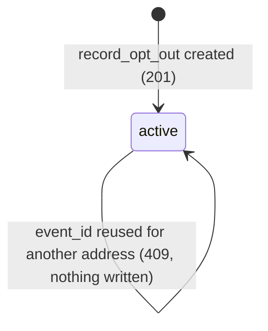

# 11 — State machines

## `message_outbox.status`

Sources: `src/platform_communication/store.py` (`create`, `claim`, `mark_sending`, `finish`), `src/platform_communication/worker.py`, `src/platform_communication/migrations.py` (status CHECK in 0001 and 0002), `docs/runtime.md`

- status ที่นับเป็น queue capacity: `queued`, `leased`, `sending`, `uncertain`
- worker ส่ง outcome `dead` ทันทีถ้า adapter ของ channel ไม่ configured (`worker.py`)

## Opt-out record (`message_opt_out`)

ไม่มี route หรือคำสั่งลบ opt-out (ไม่มี DELETE grant ใน `store.ready`)

Sources: `src/platform_communication/store.py` (`record_opt_out`), `src/platform_communication/app.py`

## Open questions

- กระบวนการ reconcile `uncertain` ของ operator ยังไม่มี runbook ใน repo
- ต้องการทางยกเลิก opt-out (re-subscribe) หรือไม่
