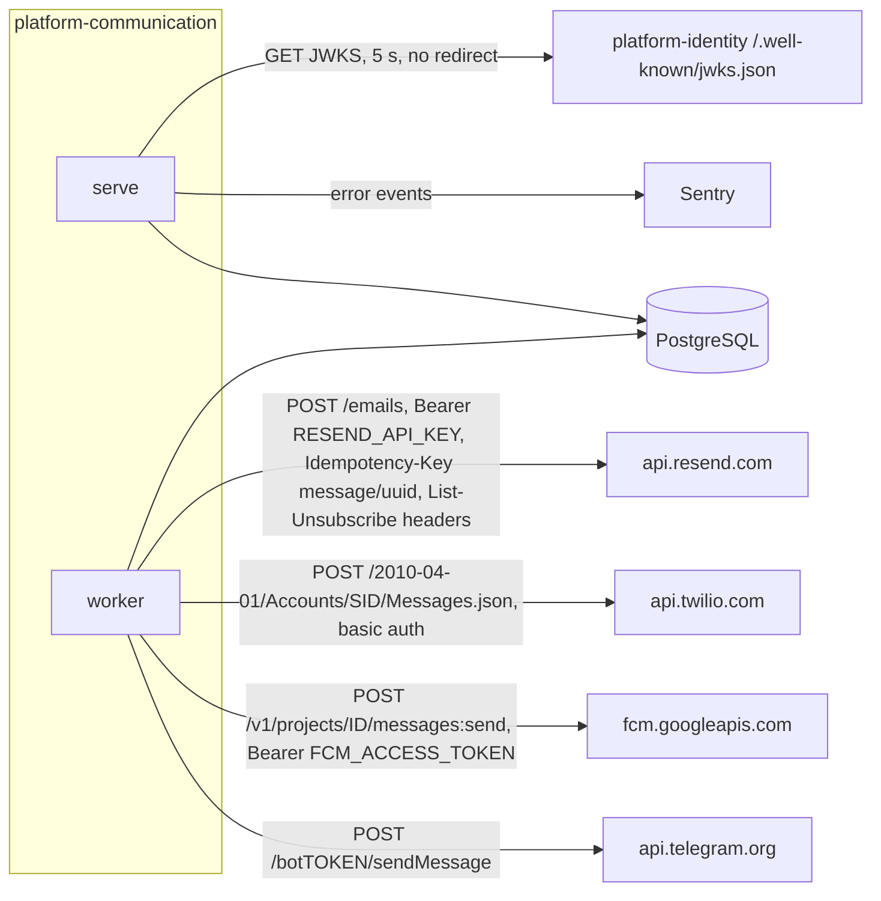

# 12 — API and integrations

Base: service `communication-api-production` บน Railway (ops record: book-platforms-status (2026-11-03)); auth = RS256 JWT ของ platform-identity, audience `communication-api`
error body ทั้งหมดเป็นข้อความทั่วไป (`invalid request`, `Invalid message`, ...) ไม่สะท้อน input

| Method | Path | Auth / scope | Idempotency | Responses |
|---|---|---|---|---|
| GET | `/healthz` | none | n/a | 200 `{"status":"ok"}` |
| GET | `/readyz` | none | n/a | 200 ready / 503 unavailable |
| GET | `/metrics` | none | n/a | Prometheus text: request counters per route template + status, duration sum |
| POST | `/v1/messages` | `messages:write` | required `Idempotency-Key` (`[A-Za-z0-9_.:-]{1,128}`); same key + same payload = same row; different payload = 409 | 202, 401, 403, 409, 413, 422, 429, 503 |
| GET | `/v1/messages?limit=1..100&after=<uuid>` | `messages:read` | read | 200 list ordered by id |
| GET | `/v1/messages/{id}` | `messages:read` | read | 200, 404 |
| POST | `/v1/opt-outs` | `opt-outs:write` | by `event_id` (UNIQUE per workspace); replay = 200 `existing`; reuse for another address = 409 | 201, 200, 409, 422 |
| GET | `/v1/unsubscribe?t=` | signed token only | read | 200 confirm page, 404 |
| POST | `/v1/unsubscribe?t=` | signed token only; body `List-Unsubscribe=One-Click` | event `unsubscribe:<message id>` so repeat click is a no-op | 200, 400, 404 |

Request body `/v1/messages` (`extra='forbid'`, `strict=True`): `channel`, `recipient` (1..512), `body` (1..4096), `subject` (email only, 1..200), `template` (`plain` | `html`, html email only), `max_attempts` (1..10, default 3)

Sources: `src/platform_communication/app.py`, `src/platform_communication/store.py`, platform-backend-core `src/platform_backend_core/http.py` at `21d5f44`

## Outbound integrations

| Channel | Env vars (all must be valid, else channel disabled) | Provider id stored |
|---|---|---|
| email | `RESEND_API_KEY`, `RESEND_FROM`, optional `COMMUNICATION_PUBLIC_URL` (https origin) | Resend `id` |
| sms | `TWILIO_ACCOUNT_SID` (`AC` + 32 hex), `TWILIO_AUTH_TOKEN`, `TWILIO_FROM` (E.164) | Twilio `sid` |
| push | `FCM_PROJECT_ID`, `FCM_ACCESS_TOKEN` (externally refreshed) | FCM `name` |
| telegram | `TELEGRAM_BOT_TOKEN` | `message_id` |

ไม่มี inbound webhook จาก provider (delivery callback ยังไม่ทำ: `docs/runtime.md`)

Sources: `src/platform_communication/adapters.py`, `src/platform_communication/__main__.py`, `docs/runtime.md`, platform-backend-core `auth.py` at `21d5f44`

## Open questions

- `/metrics` เปิดโดยไม่ต้อง auth บน public Railway domain: ตั้งใจหรือไม่ (ข้อมูลเป็น route template + count เท่านั้น)
- ไม่มี OpenAPI ที่ commit ไว้; FastAPI สร้าง `/docs` / `/openapi.json` โดย default (core ไม่ได้ปิด) ต้องการเปิดไว้หรือไม่
