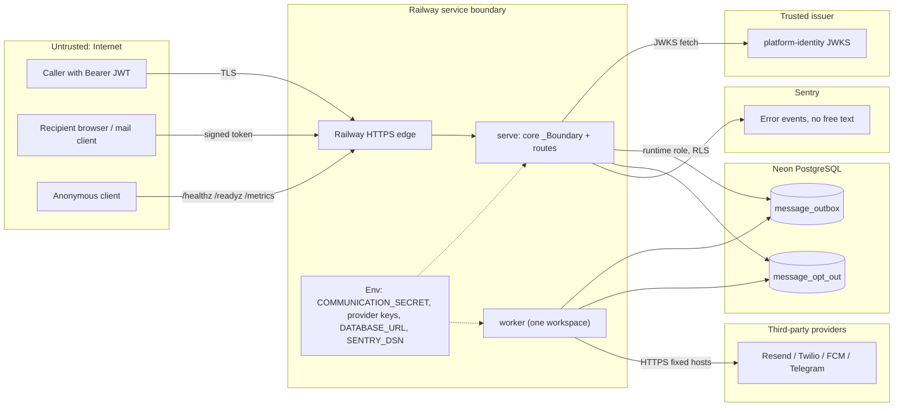

# 13 — Threat model (DFD + STRIDE)

Sources: `src/platform_communication/*.py`, platform-backend-core `http.py`, `auth.py`, `db.py` at `21d5f44`, `.railway/railway.ts`, `Dockerfile`, ops record: book-platforms-status (2026-11-03) (Railway, Neon per service, identity issuer, Sentry project)

Trust boundaries: Internet → Railway edge → service; service → Neon; service → identity JWKS; service → providers; service → Sentry
หมายเหตุ: brief กล่าวถึง gateway edge แต่ไม่พบหลักฐานว่า communication อยู่หลัง `gateway.bookchaowalit.com` (ไม่มีใน repo หรือ book-platforms-status) จึงวาด Railway edge ตรง

## STRIDE

| Element | Threat | Existing mitigation (evidence) | Gap |
|---|---|---|---|
| API `/v1/*` | **S** forged token | RS256 only, no `crit`, issuer + audience strict, required `sub ws iat exp jti` (`auth.py`); JWKS over https, no redirect | ไม่มี jti replay store (token ใช้ซ้ำได้จนหมดอายุ) |
| API `/v1/*` | **E** cross-tenant read/write | workspace จาก `ws` เท่านั้น; FORCE RLS USING + WITH CHECK; runtime role NOBYPASSRLS ถูกตรวจทุก connection (`db.py` `_configure`) | none found |
| API `/v1/messages` | **T** payload change on replay | fingerprint + 409 (`store.py`) | — |
| API `/v1/messages` | **D** flood | body ≤ 32768 bytes, 30 s timeout, `limit_concurrency=100`, queue cap 10,000/workspace | ไม่มี per-caller rate limit ใน service |
| API `/v1/messages` | **I** body / recipient echoed | API คืนเฉพาะ workspace ของ token; ไม่คืน hash, lease, provider id | `recipient` และ `body` เก็บเป็น plaintext ใน DB และคืนผ่าน GET |
| `/v1/unsubscribe` | **S** forged link / enumeration | HMAC tag 128 bit, regex exact token, `compare_digest`, 404 generic (`keys.py`) | ไม่มี expiry ของ token |
| `/v1/unsubscribe` | **T** CSRF / clickjacking | CSP `default-src 'none'; form-action 'self'; frame-ancestors 'none'`, `no-referrer`, `no-store`; GET ไม่เปลี่ยน state | — |
| `/metrics`, `/readyz` | **I** info disclosure | route template + status counts only; readiness คืน ready / unavailable เท่านั้น | public ไม่มี auth |
| Worker → providers | **T/I** SSRF / redirect leak | fixed HTTPS hosts, `follow_redirects=False`, `trust_env=False`, id regex ป้องกัน path injection (`adapters.py`, `test_endpoint_identifiers_cannot_inject_paths`) | — |
| Worker → providers | **R** duplicate or lost send | `sending` persisted before I/O; ambiguous = `uncertain` no resend; Resend idempotency key | ไม่มี delivery callback; reconcile เป็น manual |
| `message_opt_out` | **I** dump reveals addresses | HMAC hash with secret not in DB | `message_outbox.recipient` ยังเป็น plaintext |
| Env secrets | **I** leak via errors / logs | startup error เป็นข้อความทั่วไป; access log off; Sentry ไม่มี locals/free text (`_sentry.py`) | การ rotate `COMMUNICATION_SECRET` ทำให้ opt-out เดิมใช้ไม่ได้ |
| Sentry egress | **I** PII to third party | ADR-0005 scrubber; 55-case test `test_no_exception_text_leaves_the_process` | — |
| Neon | **D** compute quota / suspend | pool check per connection, wait 20 s (`db.py`); separate Neon project per service | ไม่มี backup ที่ยืนยัน (ดู 14) |
| Supply chain | **T** dependency confusion | core pinned by git SHA in uv lock; actions SHA-pinned (`test_build_hygiene.py`); gitleaks/semgrep/osv/trivy (`security.yml`) | — |

ภาพ attack path กลาง: [ATTACK-PATH-DIAGRAMS.md](https://github.com/bookchaowalit/architecture-docs/blob/main/docs/architecture/ATTACK-PATH-DIAGRAMS.md) (ไม่มี service นี้โดยตรง)

## Open questions

- ต้องการ retention/encryption ของ `recipient` และ `body` ใน outbox หรือไม่
- `/docs` และ `/openapi.json` ของ FastAPI เปิดอยู่ตาม default
