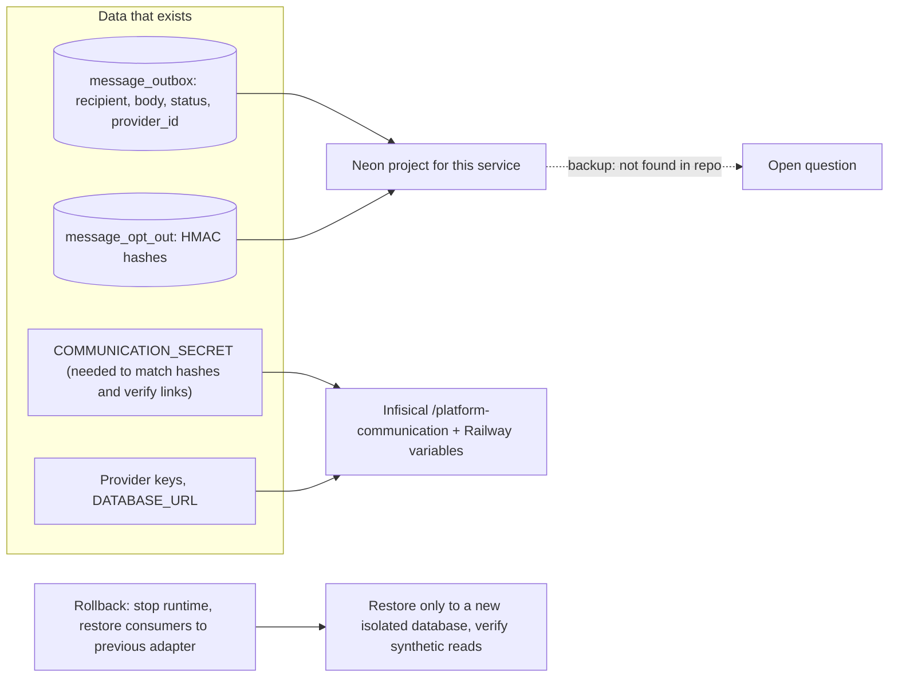

# 14 — Backup and DR

Sources: `src/platform_communication/migrations.py`, `src/platform_communication/keys.py`, `docs/runtime.md` ("Verification and release gate", "Keyed hashes", "Staging plan"), ops record: book-platforms-status (2026-11-03) ("own Neon project `platform-<svc>` and secrets in Infisical `/platform-<svc>`")

| Item | Reality |
|---|---|
| Backup workflow ใน repo | ไม่มี (`.github/workflows/` มีแค่ `check.yml`, `shared-runtime.yml`) |
| Provider features | repo และ ops record ไม่ระบุ restore window / plan ของ Neon project นี้ |
| Restore rule | restore ไปยัง database ใหม่เท่านั้น ห้าม downgrade SQL หรือเขียนทับ live DB (`docs/runtime.md`) |
| Secret dependency | ถ้าเสีย `COMMUNICATION_SECRET` opt-out ทั้งหมดจะไม่ match และ link เก่าใช้ไม่ได้ |
| RTO / RPO | not defined |
| Restore drill | not found for this service |

## Open questions

- nightly encrypted DB backup ไป R2 (baseline ของ owner) ครอบคลุม Neon `platform-communication` หรือไม่: `docs/runtime.md` บอกว่า "Runtime role and backup/restore provisioning remain operator release work"
- RTO / RPO ที่ยอมรับได้
- ใครถือสำเนา `COMMUNICATION_SECRET` นอก Infisical
