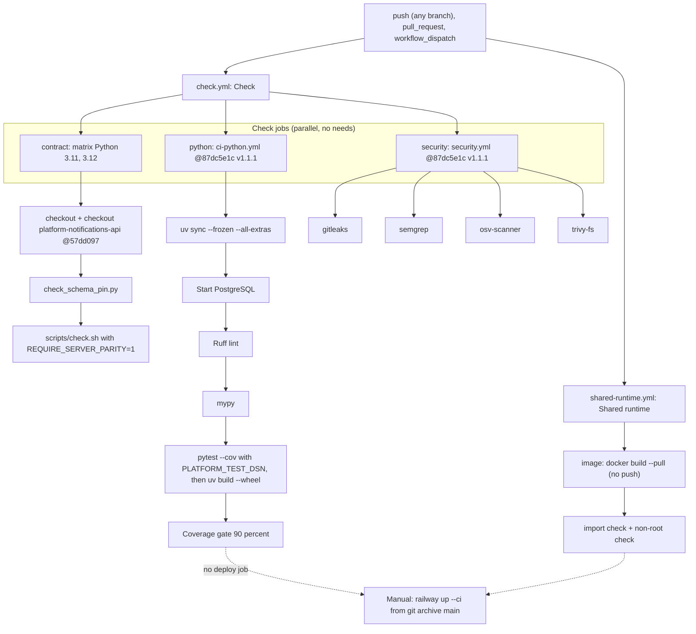

# 15 — CI/CD pipeline

Sources: `.github/workflows/check.yml`, `.github/workflows/shared-runtime.yml`, `bookchaowalit/platform-ci-workflows` `.github/workflows/ci-python.yml` and `security.yml` at `87dc5e1c`, ops record: book-platforms-status (2026-11-03) (deploy recipe)

- concurrency: `check-${{ github.ref }}` และ `shared-runtime-${{ github.ref }}` cancel-in-progress
- runner: GitHub-hosted (`ubuntu-latest` / shared default `ubuntu-24.04`) เพราะเป็น public repo
- `format-check: false` (follow-up: ruff format)

## Open questions

- ต้องการ deploy job (หรือ Railway GitHub source) แทน CLI หรือไม่
