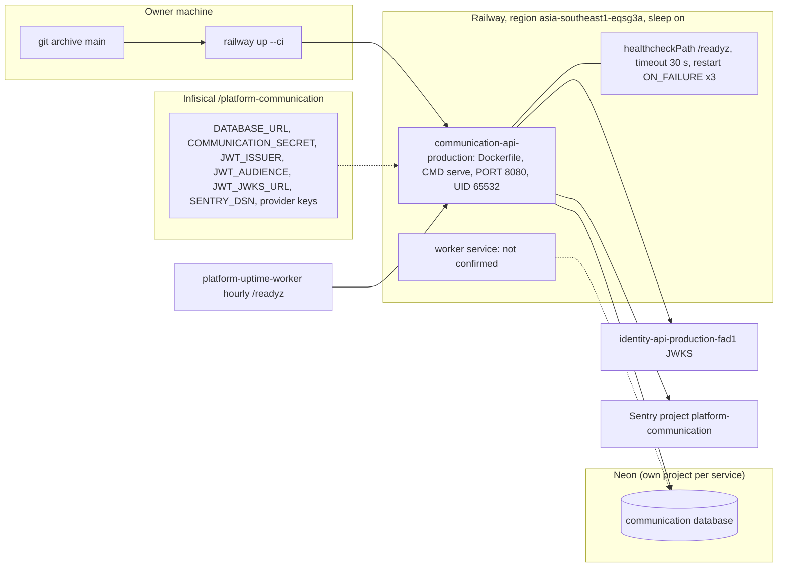

# 16 — Deployment

Sources: `railway.toml`, `Dockerfile`, `src/platform_communication/__main__.py`, `docs/runtime.md` (Staging plan), ops record: book-platforms-status (2026-11-03) (service name `communication-api-production`, region, sleep, `/readyz` 200 ~0.4 s warm, Neon `platform-<svc>`, Infisical `/platform-<svc>`, Sentry `platform-<svc>`, identity issuer `https://identity-api-production-fad1.up.railway.app`, uptime worker, CLI deploy of `bea8412`)

| Endpoint | Purpose |
|---|---|
| `/healthz` | liveness, no DB |
| `/readyz` | Railway healthcheck + uptime worker; DB, schema, RLS, privileges, at least one adapter |

## Open questions

- ~~public domain เต็มของ service~~ ตอบแล้ว 2026-11-04: `https://communication-api-production.up.railway.app` (platform-api-gateway `routes.json` @ `4a31ff5`, route `platform-communication`)
- `main` ปัจจุบันคือ `3a35541` (CI only) แต่ ops record ระบุ CLI deploy ล่าสุดที่ `bea8412`: commit ที่รันอยู่จริงคืออะไร
- Railway service สำหรับ `worker` และ `COMMUNICATION_WORKSPACE_ID` มีหรือยัง; migrate รันด้วย role ใด
- Railway sleep ทำให้ worker loop (poll 0.5 s) หลับด้วยหรือไม่ ถ้า deploy เป็น serverless
