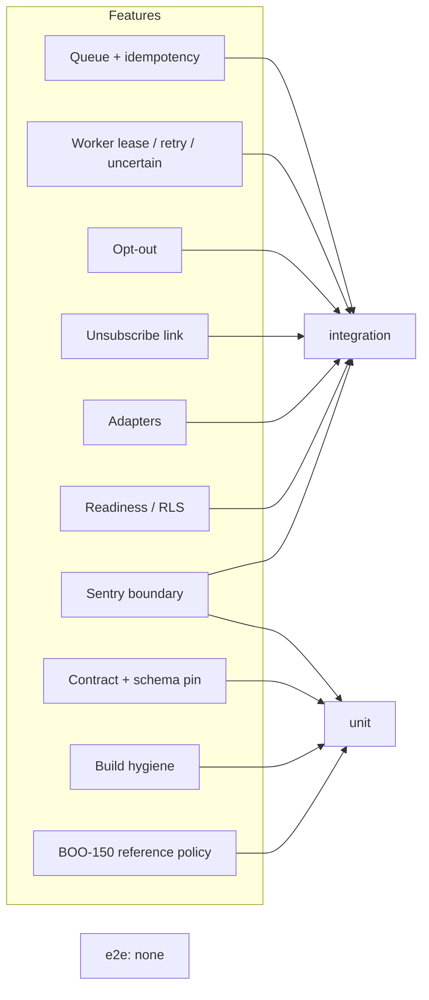

# 17 — Test coverage matrix

ระดับ test: **unit** = `tests/` (offline, stdlib `unittest`, รันใน `scripts/check.sh`); **integration** = `runtime_tests/` (PostgreSQL จริงผ่าน `PLATFORM_TEST_DSN`, JWT signature จริง, HTTP ผ่าน TestClient, provider ผ่าน injected transport); **e2e** = ไม่มี (ไม่มี test ที่เรียก service ที่ deploy แล้วหรือ provider จริง)
CI รันทั้งหมดใน job `python` ด้วย coverage gate 90% (วัดได้ 90.34% เมื่อ 2026-11-03 ตามคอมเมนต์ใน `check.yml`)

| Feature | Unit (`tests/`) | Integration (`runtime_tests/`) | E2E |
|---|---|---|---|
| Queue + idempotency, capacity | — | `test_runtime.py` (concurrent idempotency, queue bound), `test_pool_reuse.py` | gap |
| Worker lease, retry, dead, uncertain | — | `test_runtime.py` (claim fencing, persist before send, retry/dead/success) | gap |
| Validation / error mapping 422 vs 500 | — | `test_error_mapping.py` (5), `test_runtime.py::test_validation_templates_and_disabled_adapters` | gap |
| Opt-out (API, suppression, Telegram blocked) | — | `test_opt_out.py` (16) | gap |
| One-click unsubscribe + keyed hashes | — | `test_unsubscribe.py` (13) | gap |
| Provider adapters wire format, redaction, timeouts | — | `test_adapters.py` (5) | gap: no live provider acceptance |
| HTTP auth, readiness, migration checksum, privileges | — | `test_http.py` (4) | gap |
| RLS isolation | — | `test_runtime.py::test_outbox_force_rls_rejects_foreign_write_and_stale_finish` | — |
| Sentry scrubbing | `test_sentry.py` (12) | `test_sentry_boundary.py` (2, incl. 55-case no-text test) | — |
| Contract / schema / registry drift | `test_contract_check.py` (21), `test_drift_checks.py` (17) | — | — |
| Dockerfile + workflow pinning | `test_build_hygiene.py` (7) | CI `image` job builds the image | — |
| BOO-150 reference policy + server parity | `test_delivery_gate.py` (36; 5 need pinned upstream checkout) | — | — |
| Worker CLI loop (`__main__ worker`, SIGTERM) | — | — | **gap: not tested** |
| `serve` startup from env (`__main__`) | — | — | **gap: not tested** |

Sources: `tests/*.py`, `runtime_tests/*.py`, `runtime_tests/conftest.py`, `pyproject.toml` (`testpaths`, coverage `source`), `.github/workflows/check.yml`, `scripts/check.sh`

## Open questions

- smoke test หลัง deploy (`docs/runtime.md` Staging plan step 4: ส่งจริงถึง owner, replay, unsubscribe) ทำแล้วหรือไม่ และเก็บหลักฐานที่ใด
