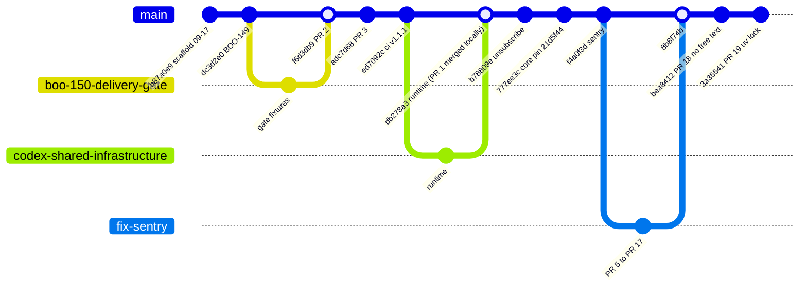
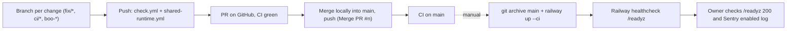

# 18 — Git and release workflow

Sources: `git log --first-parent origin/main`, `gh pr list -R bookchaowalit-backend/platform-communication --state all` (#1 closed, #2–#3 and #5–#19 merged, #4 open), `.github/workflows/*.yml`, `railway.toml`, ops record: book-platforms-status (2026-11-03) (deploy recipe, "all CLI-deployed, /readyz 200, `sentry: enabled` logged")

- merge แบบ local แล้ว push (`Merge PR #n: ...`); PR #1 ถูก close บน GitHub หลัง merge local (`db278a3`)
- ไม่มี tag หรือ GitHub release; version ใน `pyproject.toml` ยังเป็น `0.1.0`
- PR #4 (`sentry-hardened-scrubber`) ยังเปิดค้าง ถูกแทนด้วย #5–#18

## Open questions

- มี branch protection / required checks บน `main` หรือไม่ (first-parent history มี commit ที่ไม่ใช่ merge เช่น `ed7092c`, `3a35541` (PR #19 แบบ fast-forward) จึงแยกไม่ได้จาก git ว่า push ตรงหรือผ่าน PR)
- ควรปิด PR #4 หรือไม่
