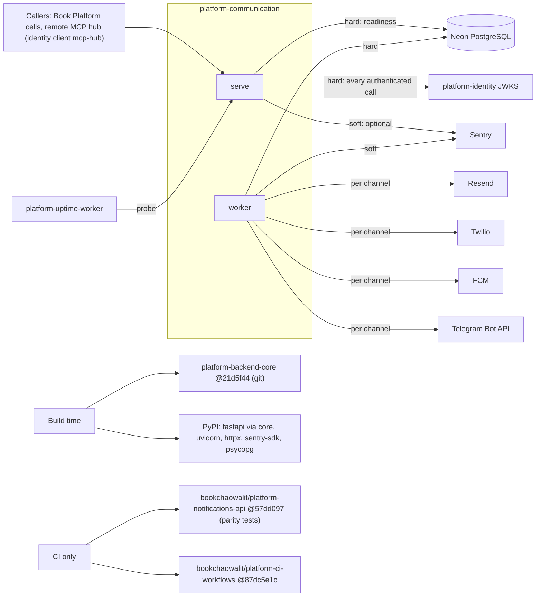

# 19 — Service dependency map

| Dependency | Type | Failure effect (from code) |
|---|---|---|
| PostgreSQL | hard | `/readyz` 503; API 500 / 504 |
| identity JWKS | hard for `/v1/messages*`, `/v1/opt-outs` | 401 (verify fails closed) |
| Provider of a channel | per channel | channel disabled → 503 at create; worker outcome `dead` / `uncertain` / retry |
| `COMMUNICATION_SECRET` | hard config | `serve` / `worker` exit at startup |
| Sentry | soft | no reporting, service unaffected |
| `contract.json` declared deps `identity`, `workflow`, `observability` | contract | no runtime call to `workflow` or `observability` found in `src/` |

Sources: `src/platform_communication/*.py`, `pyproject.toml`, `uv.lock`, `Dockerfile`, `.github/workflows/check.yml`, `contract.json`, ops record: book-platforms-status (2026-11-03)

## Open questions

- `contract.json` `depends_on` มี `workflow` และ `observability` แต่โค้ดไม่เรียก: ควรอัปเดต contract หรือมีแผนเชื่อม (เช่น workflow worker เป็น scheduler ของ `run_one`)
