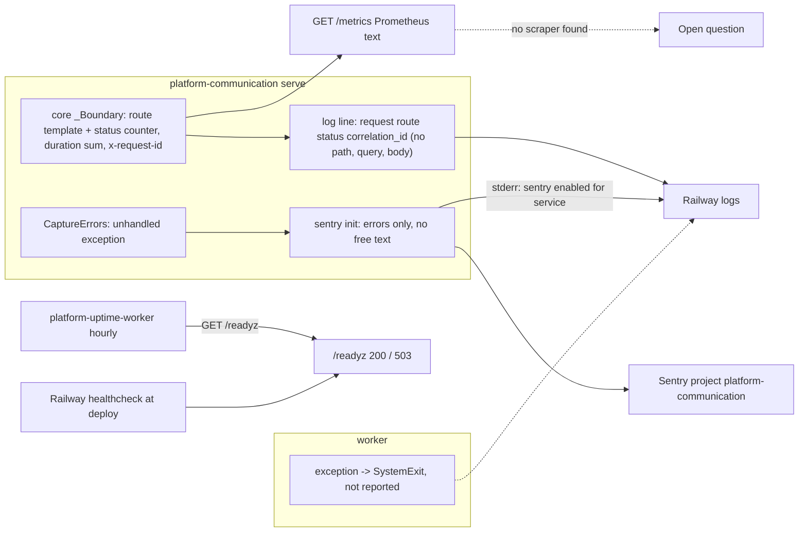

# 20 — Observability

| Signal | Source in code / record | What is watched |
|---|---|---|
| Request counters + duration | core `http.py` `_Boundary`, `/metrics` | ไม่พบ scraper (ops record: observability เป็น library, scraper จะปลุก service ที่ sleep) |
| Request log line | core `_LOG.info('request route=%s status=%d correlation_id=%s')` | Railway logs; uvicorn `access_log=False` |
| Errors | `_sentry.py` `CaptureErrors`, `init_sentry` | Sentry `platform-communication` (ops record) |
| Readiness | `/readyz` | Railway healthcheck (`.railway/railway.ts`) + uptime worker hourly (ops record) |
| Message outcome | `message_outbox.status` | ไม่มี metric หรือ alert บน `dead` / `uncertain` |

Sources: `src/platform_communication/_sentry.py`, `src/platform_communication/__init__.py`, `src/platform_communication/__main__.py`, `src/platform_communication/app.py`, platform-backend-core `http.py` at `21d5f44`, `.railway/railway.ts`, ops record: book-platforms-status (2026-11-03) (Monitoring 2026-10-29; observability decision)

## Gaps

- worker และ startup error ไม่ถึง Sentry: `__main__.main` แปลงทุก exception เป็น `SystemExit('Service configuration or dependency unavailable')` และ `_sentry.capture()` ไม่ถูกเรียกที่ใดใน `src/`
- ไม่มี heartbeat สำหรับ worker และไม่มีสัญญาณเมื่อ queue ค้าง หรือ `uncertain` เพิ่ม

## Open questions

- ต้องการ alert บน `uncertain` / `dead` count หรือ queue age หรือไม่
- Sentry alert rule ของ project นี้ส่งไปช่องทางใด (ไม่อยู่ใน repo)
