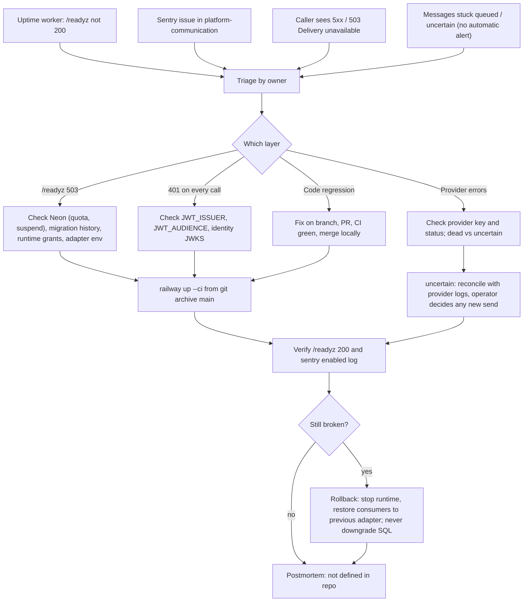

# 21 — Incident response

repo ไม่มี RUNBOOK; flow นี้ประกอบจากช่องทาง alert ที่มีจริง และกฎ rollback/reconcile ใน `docs/runtime.md`

Sources: `docs/runtime.md` ("Verification and release gate", "Outbox API and workers"), `.railway/railway.ts`, `src/platform_communication/store.py` (`ready`), `src/platform_communication/app.py`, ops record: book-platforms-status (2026-11-03) (uptime worker, Sentry project, deploy recipe, Neon resume behaviour)

## Open questions

- uptime worker และ Sentry แจ้งเตือนผ่านช่องทางใด (Telegram?) สำหรับ service นี้: ไม่อยู่ใน repo หรือ ops record
- template postmortem และที่เก็บ
- ขั้นตอน reconcile `uncertain` ต่อ provider
