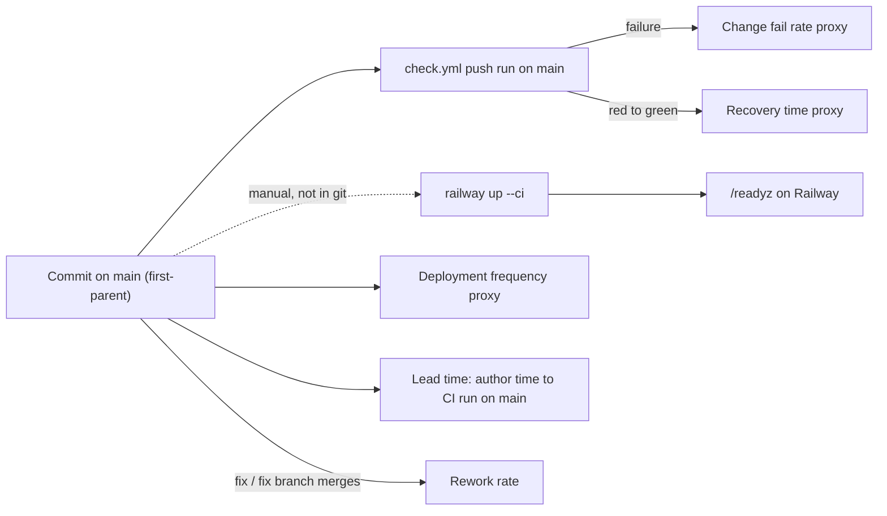

# 22 — DORA metrics

ช่วงวัด: 90 วัน **2026-08-05 → 2026-11-03** (วัดเมื่อ 2026-11-03 จาก `origin/main` `3a35541`; repo เริ่ม 2026-09-17, CI history เริ่ม 2026-10-01)

**ข้อจำกัดหลัก:** deploy ของ service นี้ทำด้วย `railway up --ci` จาก `git archive main` (ADR-0003) ไม่ผ่าน GitHub; git/gh จึงบอกได้แค่ "change เข้า `main`" และผล CI
แต่ไม่รู้ว่า commit ไหนถูก deploy เมื่อใด ข้อมูล deploy ที่มีคือ ops record: book-platforms-status (2026-11-03): live ครั้งแรก 2026-10-29 และ CLI deploy `bea8412` เมื่อ 2026-11-03

| Metric | How measured here | Value (90 days) | Command |
|---|---|---|---|
| Deployment frequency | (a) proxy: first-parent commits on `main`; (b) real Railway deploys | (a) **41 changes on 12 distinct days** (≈ 3.2 / week); 15 on 2026-11-02/03 (Sentry PR #5–#19); (b) **not computable from git/gh**: ops record names 2 (2026-10-29 go-live, 2026-11-03 `bea8412`) | `git log --first-parent --since=2026-08-05 --format=%ad --date=short origin/main \| sort \| uniq -c` |
| Lead time for changes | commit author time → creation of the first `Check` push run on `main` that contains it (72 commits since 2026-09-30) | **median ≈ 1 min**, p90 1.3 h, max 322 h (`3c17017`, runtime pilot authored 2026-10-15, reached `main` 2026-10-28 via PR #1); time to production not computable | `gh run list -R bookchaowalit-backend/platform-communication --limit 200 --json workflowName,headBranch,event,conclusion,createdAt,headSha` + `git log --format='%H %aI' <prev>..<sha>` per run |
| Change fail rate | `Check` push runs on `main` with `conclusion=failure` (`Shared runtime` on main: 0 / 23) | **9 / 37 = 24.3 %** (8 consecutive 2026-10-11 → 10-13: `b08ab60` … `34bd04a`; 1 on 2026-10-22 `62a8127`); production failures: not computable | same `gh run list` output, filtered `headBranch=main`, `event=push` |
| Failed deployment recovery time | red `Check` run on `main` → next green one | **≈ 4 d 0 h 45 m** (`b08ab60` 2026-10-11 05:33 → `dc3d2e0` 2026-10-15 06:18 UTC) and **3 min 11 s** (`62a8127` 09:41:19 → `ed7092c` 09:44:30 UTC, 2026-10-22); production recovery: not computable | same output ordered by `createdAt` |
| Deployment rework rate | first-parent commits whose subject starts with `fix`/`revert`, plus merges of `fix/*` PR branches | **17 / 41 = 41.5 %** (3 direct `fix:` + PR #5–#18 Sentry scrubber fixes) | `git log --first-parent --since=2026-08-05 --format='%h %s' origin/main \| grep -E "^[0-9a-f]+ (fix\|[Rr]evert)\|Merge PR #"` (PR #5–#18 are all `fix/` branches: `gh pr list --state all`) |

Sources: `git log origin/main`, `gh run list -R bookchaowalit-backend/platform-communication` (168 runs, 2026-10-01 → 2026-11-03), `gh pr list --state all`, `.github/workflows/check.yml`, `.github/workflows/shared-runtime.yml`, ops record: book-platforms-status (2026-11-03)

## Caveats

- CI ไม่ใช่ deploy gate: CLI deploy ทำได้แม้ CI แดง และ CI เขียวไม่ได้แปลว่า deploy แล้ว
- red streak 2026-10-11 → 10-13 เกิดช่วง rename repo / re-pin schema (ก่อนมี runtime) จึงไม่กระทบ production
- rework สูงเพราะ PR #5–#18 เป็นการแก้ scrubber ซ้ำๆ ในสองวัน ก่อนเปลี่ยนเป็น fail-closed (ADR-0005)
- lead time จาก author → CI ของ commit ที่ push ตรงใกล้ 0 เสมอ จึงไม่สะท้อนเวลาทำงานจริง

## Open questions

- จะบันทึก CLI deploy ไว้ที่ใด (เช่น Railway deployment API, หรือ log ใน registry) เพื่อวัด DF / lead time / CFR / recovery ระดับ production
- นับ deployment เป็น Railway deploy ของ `serve` อย่างเดียว หรือรวม `worker` และ `migrate`
